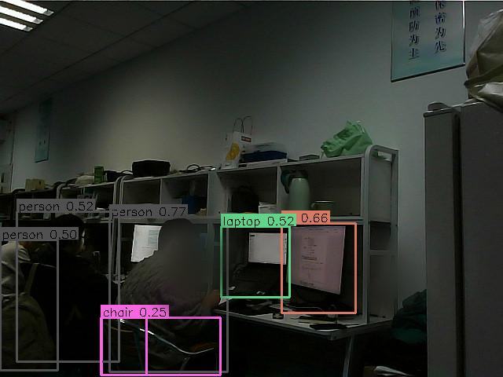

# Astra Pro + Jetson Xavier NX：RGB-D 实时目标检测与三维定位

基于 **Jetson Xavier NX（JetPack 4.6.1 / L4T R32.7.1）+ Orbbec Astra Pro + ROS Melodic** 的端到端 RGB-D 感知系统：

- Astra Pro RGB / Depth 双流采集，深度硬件对齐到彩色；
- YOLOv5n → ONNX → TensorRT FP16，C++ 实时检测；
- 检测框深度 ROI 中位数 + 相机内参反投影，输出目标三维坐标；
- XYZ / XYZRGB 点云、RViz Marker、rosbag 录制与离线回放；
- 彩色相机棋盘格标定、性能测试与 10 分钟稳定性验证。



*演示图片中的人脸已做模糊处理。*

> 当前定位：**可运行、可回放、可测试的工程原型（MVP）**。
> 彩色相机标定与 10 分钟稳定性已完成；0.8–2.0m 卷尺精度实测和 RViz 现场截图仍需现场配合。
> 详见 [docs/test_report.md](docs/test_report.md)。

---

## 1. 核心特性

| 能力 | 实现 |
|---|---|
| RGB-D 采集 | Astra Pro UVC RGB + OpenNI2 Depth，640×480@30Hz |
| 深度对齐 | `depth_align:=true`，深度图在 `camera_color_optical_frame` |
| RGB-D 同步 | `message_filters::ApproximateTime`，统计时间差/丢帧 |
| 点云 | PCL XYZ / XYZRGB，10Hz 限速，默认 step=2 |
| 目标检测 | YOLOv5n，TensorRT 8.2 FP16，COCO 80 类 |
| 三维定位 | ROI 深度中位数 + 内参反投影，输出 `Object3DArray` |
| 可视化 | RViz 图像、点云、TF、Objects3D Marker |
| 离线回放 | rosbag 录制/播放，无相机可复现 |
| 标定 | 9×6 / 25mm 棋盘格，自动采集 + `cv2.calibrateCamera` |
| 工程化 | benchmark/stability 脚本、录制/回放、Doxygen 注释 |

### 实测指标（Xavier NX 20W / 办公室场景）

| 指标 | 结果 |
|---|---|
| Color / Depth | 30.1 / 29.8 Hz |
| 检测输出 | 28–30 FPS |
| 检测端到端延迟 | mean 35.6ms，p95 38.1ms |
| 三维输出 | 27.2 FPS |
| 三维延迟 | mean 53.9ms，p95 76.8ms |
| 3D 有效深度成功率 | 82.6%（1084/1313） |
| Engine-only | 7.36ms/帧，约 130 QPS（trtexec） |
| 10 分钟稳定性 | 无崩溃、无 USB 断连、gaps=0、RSS 稳定 |

> 以上为实测值，不含未执行的 0.8–2.0m 卷尺误差表。详细数据见
> [docs/performance_report.md](docs/performance_report.md)。

---

## 2. 硬件与软件

### 硬件

- NVIDIA Jetson Xavier NX Developer Kit（16GB 模组实测可见 15GiB）。
- Orbbec Astra Pro（RGB `2bc5:0501` + Depth `2bc5:0403`），USB 2.0。
- 建议 20W 6 核模式：`sudo nvpmodel -m 8`。
- 至少 8GB 可用磁盘（engine + rosbag）。

### 软件

| 组件 | 版本 |
|---|---|
| L4T / JetPack | R32.7.1 / 4.6.1 |
| Ubuntu | 18.04.6 LTS |
| ROS | Melodic（Python 2.7） |
| CUDA | 10.2.300 |
| cuDNN | 8.2.1.32 |
| TensorRT | 8.2.1（`/usr/src/tensorrt/bin/trtexec`） |
| OpenCV | 4.1.1（工作空间内重建 cv_bridge） |
| PCL | 1.8.1 |
| 编译器 | gcc/g++ 7.5.0，cmake 3.10.2 |

> 不要为了“修兼容”升级 JetPack/CUDA/TensorRT。项目已通过补丁处理
> OpenCV 3.2/4.1、cv_bridge、UVC CameraInfo 和 FP16 TensorRT 的兼容问题。

---

## 3. 系统架构

```
                 Orbbec Astra Pro (USB 2.0)
                 |                         |
        UVC RGB (2bc5:0501)      OpenNI2 Depth (2bc5:0403)
                 |                         |
                 +-------- astra_camera ---+
                     depth_align:=true
                     /camera/color/image_raw       rgb8   640x480
                     /camera/depth/image_raw       16UC1  640x480, mm
                     /camera/color/camera_info
                     /camera/depth/camera_info
                     /tf
                              |
              +---------------+----------------+
              |                                |
      rgbd_sync_node                     detector_node
      - ApproximateTime sync             - letterbox 640x640
      - XYZ / XYZRGB point clouds        - TensorRT FP16 YOLOv5n
      - sync statistics                  - decode + class-wise NMS
              |                                |
   /perception/points_xyz                  /perception/detections_2d
   /perception/points_xyzrgb               /perception/image_annotated
   /perception/sync_stats                         |
                                                  v
                                        depth_localizer_node
                                        - central 50% ROI
                                        - median depth / valid ratio
                                        - back-projection with CameraInfo
                                                  |
                                        /perception/objects_3d
                                        /perception/markers
                                                  |
                                                 RViz
```

### ROS 节点

| 节点 | 作用 |
|---|---|
| `camera` | Astra Pro 驱动：RGB/Depth/CameraInfo/TF |
| `rgbd_sync` | RGB-D 同步、点云、统计 |
| `detector` | TensorRT YOLOv5n 检测、标注图 |
| `depth_localizer` | 深度 ROI + 三维反投影 + Marker |
| `rviz` | 可视化 |

### 目录结构

```
.
├── src/astra_rgbd_perception/
│   ├── include/astra_rgbd_perception/trt_engine.hpp
│   ├── src/
│   │   ├── rgbd_sync_node.cpp
│   │   ├── detector_node.cpp
│   │   ├── depth_localizer_node.cpp
│   │   └── trt_engine.cpp
│   ├── msg/
│   │   ├── Detection2D.msg
│   │   ├── Detection2DArray.msg
│   │   ├── Object3D.msg
│   │   ├── Object3DArray.msg
│   │   └── RgbdSyncStats.msg
│   ├── launch/          rgbd / detector / localizer / system
│   ├── config/          YAML + coco.names + rgbd_view.rviz
│   └── scripts/         record / play / benchmark / stability / calibrate / measure
├── docs/                安装、使用、架构、性能、测试、用户手册、API
├── patches/             第三方仓库最小补丁
├── tools/               9×6 / 25mm 棋盘格
├── models/              ONNX/engine 说明（大文件不入库）
└── Doxyfile             Doxygen 配置
```

---

## 4. 快速开始

以下命令假设工作空间为 `~/astra_rgbd_ws`。

### 4.1 获取代码

```bash
git clone <your-repo-url> ~/astra_rgbd_ws
cd ~/astra_rgbd_ws
```

### 4.2 一键部署（推荐）

```bash
bash src/astra_rgbd_perception/scripts/setup_board.sh
```

脚本会：

1. 安装 apt 依赖（可用 `SKIP_APT=1` 跳过）；
2. 克隆 `ros_astra_camera`、`vision_opencv` 并锁定 commit；
3. 应用 `patches/` 下的最小补丁；
4. 编译并安装 libuvc 到 `/usr/local`；
5. 安装 Orbbec udev 规则（自动备份旧规则）；
6. `catkin_make -j4`；
7. 可选 `BUILD_ENGINE=1` 下载 ONNX 并构建 TensorRT engine。

如果本板的 apt 被 `v2rayn` 等包阻塞，请先看
[docs/installation.md 第 2.1 节](docs/installation.md) 的安全绕法，再
`SKIP_APT=1` 运行脚本。

### 4.3 手动安装（摘要）

```bash
# 依赖
sudo apt install -y libdw-dev libelf-dev libudev-dev libusb-1.0-0-dev \
  libeigen3-dev libgflags-dev v4l-utils ros-melodic-backward-ros \
  ros-melodic-rgbd-launch ros-melodic-image-geometry \
  ros-melodic-camera-info-manager ros-melodic-image-publisher

# 第三方源码
cd ~/astra_rgbd_ws/src
git clone https://github.com/orbbec/ros_astra_camera.git
git -C ros_astra_camera checkout 210f530144314da7c70072215bacba12130d9b20
git clone -b melodic https://github.com/ros-perception/vision_opencv.git
git -C vision_opencv checkout 0818d3a1a76017c62e6a0fb2fdc2d343892b4205

# 补丁
cd ~/astra_rgbd_ws
git -C src/ros_astra_camera apply patches/ros_astra_camera.patch
git -C src/vision_opencv apply patches/vision_opencv_opencv4.patch

# libuvc
rm -rf /tmp/libuvc_build && mkdir -p /tmp/libuvc_build
unzip -q src/ros_astra_camera/dependencies/libuvc_master_d3318ae72.zip \
  -d /tmp/libuvc_build
cd /tmp/libuvc_build/libuvc && rm -rf build && mkdir build && cd build
cmake .. -DCMAKE_INSTALL_PREFIX=/usr/local -DCMAKE_BUILD_TYPE=Release \
         -DBUILD_EXAMPLES=OFF
make -j4 && sudo make install && sudo ldconfig

# udev
sudo cp src/ros_astra_camera/56-orbbec-usb.rules /etc/udev/rules.d/
sudo udevadm control --reload-rules && sudo udevadm trigger

# 编译
cd ~/astra_rgbd_ws
source /opt/ros/melodic/setup.bash
catkin_make -j4
source devel/setup.bash
```

### 4.4 构建 TensorRT engine

```bash
cd ~/astra_rgbd_ws
mkdir -p models
curl -L --retry 3 -o models/yolov5n.onnx \
  https://github.com/ultralytics/yolov5/releases/download/v7.0/yolov5n.onnx
sha256sum models/yolov5n.onnx
# 04f0e55c26f58d17145b36045780fe1250d5bd2187543e11568e5141d05b3262

export PATH=/usr/local/cuda/bin:$PATH
/usr/src/tensorrt/bin/trtexec \
  --onnx=models/yolov5n.onnx \
  --saveEngine=models/yolov5n_fp16.engine \
  --fp16
```

- 构建约 15–25 分钟；engine 约 7MB。
- 输入 `images 1x3x640x640`，输出 `output0 1x25200x85`，FP16 binding。
- engine 与设备/TensorRT 版本绑定，换板后必须重建；不要提交到 Git。

### 4.5 标定（本机已完成；换相机需重做）

```bash
# 终端 1：相机
roslaunch astra_camera astra_pro.launch depth_align:=true \
  enable_point_cloud:=false enable_ir:=false

# 终端 2：自动标定
python2 ~/astra_rgbd_ws/src/astra_rgbd_perception/scripts/calibrate_rgb.py \
  --cols 9 --rows 6 --square 0.025 --min-views 15 --max-views 25 --timeout 300
```

使用 `tools/chessboard_9x6_25mm.pdf`（A4 横向、100% 实际大小、25mm 方格）。
本机标定结果：

```
K = [568.6674, 0, 316.2128, 0, 568.3721, 261.5965, 0, 0, 1]
D = [0.049442, -0.007669, 0.000592, 0.002328, -0.147309]
```

标定文件安装到 `~/.ros/camera_info/rgb_camera.yaml`；归档见
`docs/calibration/`。`fallback_intrinsics` 已设为 `false`。

### 4.6 启动

```bash
source /opt/ros/melodic/setup.bash
source ~/astra_rgbd_ws/devel/setup.bash

# 完整系统（有显示器）
roslaunch astra_rgbd_perception system.launch

# SSH / 无显示器
roslaunch astra_rgbd_perception system.launch use_rviz:=false
```

参数：

| 参数 | 默认 | 说明 |
|---|---|---|
| `start_camera` | true | 启动 Astra 驱动 |
| `depth_align` | true | 深度对齐到彩色 |
| `use_sync` | true | 点云/同步 |
| `use_detector` | true | YOLO 检测 |
| `use_localizer` | true | 三维定位 |
| `use_rviz` | true | RViz |
| `engine_path` | `.../models/yolov5n_fp16.engine` | TensorRT engine |

### 4.7 查看结果

```bash
rostopic hz /camera/color/image_raw
rostopic hz /camera/depth/image_raw
rostopic hz /perception/detections_2d
rostopic hz /perception/objects_3d
rostopic echo -n1 /perception/sync_stats
rostopic echo -n1 /perception/objects_3d

rqt_image_view /perception/image_annotated
rviz -d ~/astra_rgbd_ws/src/astra_rgbd_perception/config/rgbd_view.rviz
```

---

## 5. Topic 与消息

| Topic | 类型 | 说明 |
|---|---|---|
| `/camera/color/image_raw` | `sensor_msgs/Image` | RGB，`rgb8` |
| `/camera/depth/image_raw` | `sensor_msgs/Image` | 对齐深度，`16UC1`，mm |
| `/camera/color/camera_info` | `sensor_msgs/CameraInfo` | 彩色内参 |
| `/camera/depth/camera_info` | `sensor_msgs/CameraInfo` | 对齐深度内参（=彩色 K） |
| `/perception/detections_2d` | `Detection2DArray` | 2D 检测 |
| `/perception/image_annotated` | `sensor_msgs/Image` | 标注图（bgr8） |
| `/perception/objects_3d` | `Object3DArray` | 三维目标 |
| `/perception/markers` | `MarkerArray` | RViz 标记 |
| `/perception/points_xyz` | `PointCloud2` | XYZ 点云 |
| `/perception/points_xyzrgb` | `PointCloud2` | XYZRGB 点云 |
| `/perception/sync_stats` | `RgbdSyncStats` | 同步/点云统计 |

`Object3D` 字段：

- `class_id` / `class_name` / `confidence`
- `xmin/ymin/xmax/ymax`
- `depth_m`：ROI 有效深度中位数（米）
- `valid_depth_pixels` / `valid_depth_ratio`
- `position`：X/Y/Z（米，彩色光学坐标系）
- `depth_valid`：有效深度不足时为 `false`，此时不要使用 `position`

---

## 6. 三维定位原理

对每个检测框：

1. 取中心 50% ROI；
2. 过滤 0、非有限、`<0.3m`、`>8m` 的深度；
3. 有效像素不足（<10 或 <5%）时标记 `depth_valid=false`；
4. `Z = median(valid_depth)`；
5. 用有效像素平均 `(u,v)` 反投影：

```
X = (u - cx) * Z / fx
Y = (v - cy) * Z / fy
```

彩色相机标定后，`fx≈568.67, fy≈568.37, cx≈316.21, cy≈261.60`。
对齐深度使用同一组内参。

---

## 7. 模型部署

- 模型：Ultralytics YOLOv5 v7.0 官方 `yolov5n.onnx`
- 输入：`1x3x640x640`，letterbox，RGB，`/255`
- 输出：`1x25200x85`（`cx,cy,w,h,objectness,80×class_score`）
- 后处理：objectness × class score、反 letterbox、class-wise NMS
- FP16 engine：GPU 7.36ms/帧，约 130 QPS（trtexec）
- 检测节点：28–30 FPS，端到端 35.6ms

完整说明见 [docs/model_deployment.md](docs/model_deployment.md)。

---

## 8. 录制、回放、性能、稳定性

```bash
# 录制 10 秒
bash ~/astra_rgbd_ws/src/astra_rgbd_perception/scripts/record_rgbd.sh 10

# 离线回放（先启动无相机的 system.launch）
roslaunch astra_rgbd_perception system.launch start_camera:=false use_rviz:=false
bash ~/astra_rgbd_ws/src/astra_rgbd_perception/scripts/play_rgbd.sh \
  ~/astra_rgbd_ws/bags/<bag>.bag -r 1

# 性能
bash ~/astra_rgbd_ws/src/astra_rgbd_perception/scripts/benchmark.sh 10

# 10 分钟稳定性
bash ~/astra_rgbd_ws/src/astra_rgbd_perception/scripts/stability_test.sh 600 30

# 0.8–2.0m 距离实测
python2 ~/astra_rgbd_ws/src/astra_rgbd_perception/scripts/measure_distance.py \
  --class bottle --duration 5 --show-all
```

---

## 9. 当前完成度与已知限制

### 已完成

- 相机、深度对齐、RGB-D 同步、点云；
- YOLOv5n TensorRT FP16 C++ 检测；
- 三维定位、Object3D、RViz Marker；
- system.launch 集成；
- 彩色相机标定并修复 UVC CameraInfoManager；
- rosbag 录制/离线回放；
- 性能测试与 10 分钟稳定性；
- 安装/使用/架构/性能/测试文档 + Doxygen 注释。

### 待完成/已知限制

| 项目 | 状态 |
|---|---|
| 0.8 / 1.0 / 1.5 / 2.0m 卷尺误差表 | 待用户现场配合 |
| RViz 现场截图 | 配置/topic 已验证，截图待补 |
| 标定 RMS 归档 | 归档的是标注视图，RMS 未记录 |
| 多目标跟踪 / 3D 平滑 | 未实现（每帧独立检测，3D 会抖动） |
| 3D 框 / 6DoF 位姿 | 未实现 |
| 自定义数据训练 | 未实现，当前为 COCO 预训练模型 |
| INT8 / CUDA 预处理 | 未实现，当前 FP16 + CPU 预处理 |
| 生产化 | 无 systemd/watchdog/容器/CI |

### 深度相机的固有局限

- 反光、透明、深色物体和显示器屏幕容易无深度；
- 典型量程 0.6–8m，太近/太远无效；
- 强阳光、遮挡阴影、多路径会影响结构光；
- USB 2.0 带宽有限，不建议同时开 1280×720 RGB + 深度 + 全量点云。

---

## 10. 常见问题

| 现象 | 处理 |
|---|---|
| `cv_bridge` 报 `/usr/include/opencv` 不存在 | 应用 `vision_opencv_opencv4.patch` 并重建，见 installation |
| 彩色 K 为 0 | 检查 `~/.ros/camera_info/rgb_camera.yaml`，重启相机 |
| depth K 为 0、彩色正常 | 确认 UVC CameraInfoManager 补丁已应用 |
| engine 输出全 0/异常 | 检查 binding dtype（FP16/FP32），使用当前 `TrtEngine` |
| 检测只有 ~9 FPS | 确认编译加 `-O3`、`debug_output:false`、20W 模式 |
| 深度前几帧全 0 | 冷启动，连续订阅约 1 秒 |
| apt 被 `v2rayn` 阻塞 | 使用 `apt-get download` + `dpkg -i`，不要盲目 `--fix-broken` |
| USB 断连/带宽 | 降低分辨率/帧率，使用带供电 hub |

更多见 [docs/user_manual.md](docs/user_manual.md)。

---

## 11. 文档

- [用户手册](docs/user_manual.md)
- [安装与部署](docs/installation.md)
- [系统架构](docs/architecture.md)
- [相机配置与标定](docs/camera_configuration.md)
- [模型与 TensorRT](docs/model_deployment.md)
- [性能报告](docs/performance_report.md)
- [测试报告](docs/test_report.md)
- [命令速查](docs/usage.md)
- [环境审计](docs/environment_report.md)
- [标定归档](docs/calibration/README.md)

### Doxygen API 文档

代码采用 **Doxygen 英文 API 注释 + 中文逻辑注释** 双语：
Doxygen 负责类/方法/参数的接口文档，普通 `//` / `#` 中文注释解释算法与工程细节。
生成 HTML：

```bash
cd ~/astra_rgbd_ws
doxygen Doxyfile
# 打开 docs/doxygen/html/index.html
```

生成的 HTML 不提交到 Git（见 `.gitignore`）。

---

## 12. 后续路线

**P0（展示/验收）**

- 完成 0.8–2.0m 误差表；
- 补 RViz 截图/演示 GIF；
- 归档标定 RMS。

**P1（算法深度）**

- ByteTrack/DeepSORT 跟踪 + Kalman/EMA 3D 平滑；
- 深度孔洞填充/飞点过滤/平面分割/点云聚类；
- 3D 框或 6DoF 位姿；
- 自定义数据微调 YOLOv5n；
- INT8、CUDA 预处理、pinned memory。

**P2（系统/应用）**

- 机械臂抓取（MoveIt + GraspNet）；
- SLAM/语义地图；
- RGB-D + IMU/LiDAR 融合；
- ROS2 + 新平台迁移；
- IoT 节点（如 BL602 Wi-Fi/BLE）做告警/低功耗触发。

---

## 13. 许可证与致谢

本项目代码以 **MIT License** 发布，见 [LICENSE](LICENSE)。

第三方组件：

- [orbbec/ros_astra_camera](https://github.com/orbbec/ros_astra_camera)（Apache-2.0），
  锁定 `210f530144314da7c70072215bacba12130d9b20`
- [ros-perception/vision_opencv](https://github.com/ros-perception/vision_opencv)
  （BSD，melodic 分支），锁定 `0818d3a1a76017c62e6a0fb2fdc2d343892b4205`
- [Ultralytics YOLOv5](https://github.com/ultralytics/yolov5)（AGPL-3.0，
  模型使用请遵守其许可证）
- NVIDIA TensorRT / CUDA，OpenCV，PCL，ROS Melodic

> 注意：YOLOv5 代码/权重受 AGPL-3.0 约束。本仓库只下载官方 ONNX 用于
> 研究与演示；如需商业闭源分发，请评估许可证或替换模型。